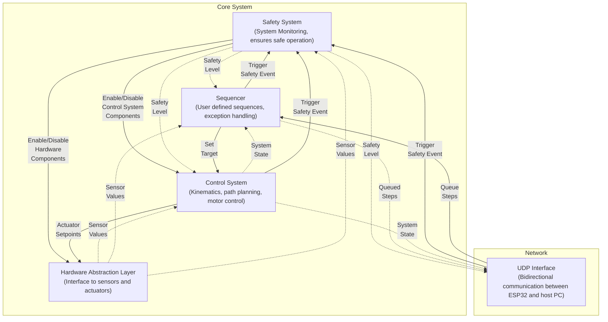

# Mobiler Ausbildungsroboter ESP32

[](https://github.com/robotics-ost/met3_r_template/actions/workflows/pages/pages-build-deployment)&emsp;
[](https://github.com/robotics-ost/met3_r_template/actions/workflows/create_release_on_tag.yml)&emsp;
[](https://robotics-ost.github.io/met3_r_template/)

This repository contains the starter code for the **MeT3_R practical exercises**. You will program a mobile differential-drive robot built on the **Waveshare General Driver for Robots (ESP32-WROOM-32UE)** using **C**, **ESP-IDF** and **PlatformIO**.

> [!IMPORTANT]
> **New here? Work through the [Quick Start](#quick-start) below, step by step.**
> Almost all problems at the start are caused by a skipped step.

## Where do I find what?

| I want to ... | Read this |
|---|---|
| install the required software (once per computer) | [Getting Started](docs/GETTING_STARTED.md) |
| read the task of an exercise | [Exercises](#exercises) |
| use Git and GitHub (commit, push, tags, fixing problems) | [Git Guide](docs/GIT_GUIDE.md) |
| understand C, coming from Python | [C for Python Programmers](docs/C_FOR_PYTHON_PROGRAMMERS.md) |
| know where to put my code and how to add a module | [Working with the Code](docs/WORKING_WITH_THE_CODE.md) |
| plot data / send commands from my PC | [Web GUI](docs/WEB_GUI.md) |
| fix an error or a problem | [Troubleshooting](docs/TROUBLESHOOTING.md) |
| look up a function or struct | [API documentation (Docs Hub)](https://robotics-ost.github.io/met3_r_template/) |

> [!TIP]
> The [online documentation](https://robotics-ost.github.io/met3_r_template/) is versioned. By default it shows the **latest version**, including fixes and improvements made during the semester. Use the version selector at the top right to view the documentation of the version your repository was created from (e.g. `v1.0.0`).

## Quick Start

> [!NOTE]
> Keyboard shortcuts in this documentation are given for Windows and Linux. On macOS, use `Cmd` instead of `Ctrl`.

### Step 1: Install the software

Install Git, VS Code, PlatformIO, the USB driver and Python as described in **[Getting Started](docs/GETTING_STARTED.md)**. You only need to do this once per computer.

### Step 2: Create your own repository

1. Open <https://github.com/robotics-ost/met3_r_template> and sign in to GitHub.
2. Click the green button **Use this template** &rarr; **Create a new repository**.
3. Choose your own account as *Owner*, enter a name (e.g. `met3_r_yourname`) and select **Private**.
4. Click **Create repository**.
5. Add your lecturers as collaborators: in your new repository go to **Settings** &rarr; **Collaborators** &rarr; **Add people**. You find their GitHub usernames on Moodle.

> [!WARNING]
> Do **not** click *Fork* and do **not** download the code as ZIP. Use **Use this template**.

### Step 3: Clone the repository to your computer

1. Open VS Code and open the **Command Palette** (`Ctrl+Shift+P`).
2. Type **Git: Clone**, press Enter and choose **Clone from GitHub**.
3. Select **your** repository (not `robotics-ost/met3_r_template`) and choose a folder to store it.

> [!WARNING]
> **The folder path must not contain spaces or special characters (ä, ö, ü, ...) and must not be inside OneDrive.** Otherwise the build fails with confusing errors.
> - Good: `C:\robotics\met3_r_yourname`
> - Bad: `C:\Users\Max Muster\OneDrive\Desktop\met3_r_yourname`

### Step 4: Open the project in VS Code

Open the folder that contains the file `platformio.ini` (**File** &rarr; **Open Folder...**). Not a parent folder, not a subfolder.

> [!NOTE]
> The first time you open the project, PlatformIO downloads the ESP32 toolchain. **This can take 10&ndash;20 minutes.** Wait until the progress messages in the bottom right corner have disappeared.

### Step 5: Enter the WiFi credentials

1. In the folder `include/`, copy the file `wifi_secrets.h.example` and name the copy **`wifi_secrets.h`**.
2. Open `include/wifi_secrets.h` and replace `YOUR_SSID` and `YOUR_PASSWORD` with the WiFi credentials given by your lecturer.
3. Connect your PC to the **same WiFi network**. Otherwise the web GUI cannot reach the robot later on. (Not needed if you use a hotspot on your laptop, see below.)

> [!TIP]
> Instead of the university WiFi, you can also use a hotspot on your laptop.
> **The ESP32 only supports 2.4 GHz.** Set the hotspot to the 2.4 GHz band (Windows: **Settings** &rarr; **Network & internet** &rarr; **Mobile hotspot** &rarr; **Properties** &rarr; **Edit** &rarr; **Network band**).

> [!CAUTION]
> `wifi_secrets.h` is ignored by Git on purpose, so your password never ends up on GitHub. **Never write the password into `wifi_secrets.h.example`** or any other file.

### Step 6: Give your robot a unique name

Open `include/config.h` and set `UDP_INTERFACE_HOSTNAME` to a name **no one else uses** (agree on the names with your fellow students). Several robots with the same name on the same WiFi network cannot be told apart.

### Step 7: Build, upload and check

Connect the robot to your computer with a USB cable. Then use the PlatformIO buttons in the **status bar at the very bottom** of VS Code:

| Button | Action |
|---|---|
| ✓ (check mark) | **Build**: compile the code |
| &rarr; (arrow) | **Upload**: compile and flash the code onto the robot |
| plug icon | **Serial Monitor**: show the messages printed by the robot |

Click **Upload**, then **Serial Monitor**. If everything works, you see a line like this:

```text
I (1234) Main Application: Application started.
```

### Step 8: Connect to the robot from your PC

Set up and start the web GUI on your PC as described in the [Web GUI guide](docs/WEB_GUI.md). In `host_interface/esp32_config.json`, enter the **same hostname** as in Step 6, followed by `.local` (e.g. `robot_1.local`).

If the plots in the browser show live data, everything works. **Done!**

If the hostname cannot be found, use the robot's IP address instead. The robot prints it in the Serial Monitor after connecting to the WiFi (`Got IP: ...`).

### Step 9: Save your work regularly (commit &amp; push)

Commit and push your changes at the end of every lab session, so that your work is backed up on GitHub. In VS Code: click the **Source Control** icon in the left side bar, **stage** your changes (**+** icon next to each file), enter a short message, click **Commit**, then **Sync Changes**. More in the [Git Guide](docs/GIT_GUIDE.md).

**Next:** start with [Exercise 01](exercises/01_robot_basics.md).

## Exercises

| # | Exercise | Starter code |
|---|---|---|
| 01 | [Robot basics, encoders and motor voltage](exercises/01_robot_basics.md) | &ndash; |
| 02 | [DC motor control, part 1](exercises/02_dc_motor_control_1.md): motor model, PD position controller | `motor_model`, `pd_controller` |
| 03 | [DC motor control, part 2](exercises/03_dc_motor_control_2.md): steer-by-wire, PI velocity controller | `pi_controller` |
| 04 | [Kinematics](exercises/04_kinematics.md): forward kinematics, odometry, inverse kinematics | `kinematics` |
| 05 | [Position control in Cartesian space](exercises/05_cartesian_position_control.md) | `position_controller_diff_drive` |
| 06 | [End-effector (TCP) control](exercises/06_tcp_control.md) | &ndash; |

Each exercise builds on the previous ones. The starter code is in `exercises/starter_code/`.

## Project structure

The files you will work with most are marked in **bold**.

| Path | Content |
|---|---|
| **`include/config.h`** | All configuration constants (task periods, controller gains, ...) |
| `include/wifi_secrets.h` | Your WiFi credentials (created by you in Quick Start Step 5, not on GitHub) |
| **`src/main.c`** | Program entry point: initializes all components and starts the tasks |
| **`lib/control_system/`** | Control system: your controllers, kinematics, ... go here |
| `lib/hal/` | Hardware abstraction layer: motor and encoder drivers |
| `lib/safety_system/` | Safety state machine |
| `lib/sequencer/` | Sequence of steps (e.g. "move to", "wait") |
| `lib/udp_interface/` | WiFi and UDP communication with your PC |
| **`exercises/`** | Exercise descriptions and starter code (`exercises/starter_code/`) |
| `host_interface/` | Python web GUI to plot telemetry and send commands from your PC |
| `.github/` | Automation of the template repository (documentation, releases). Not needed in your repository, you can delete it |

## Architecture Overview

The core system is designed in four layers (Safety System, Control System, Sequencer, Hardware Abstraction Layer). In addition, the network interface enables the user to interact with the robot via telemetry. Solid lines indicate write operations, while dashed lines stand for read only.



| Layer | Target Core | Priority |
|---|---|---|
| **Sequencer** | Core 0 | Non RT (~50-100 Hz) |
| **Control System** | Core 1 | Hard RT (~500-1000 Hz) |
| **Safety System** | Core 1 | Hard RT (500-1000 Hz) |
| **HAL** | Core 0 | Direct Register Access |
| **UDP Telemetry** | Core 0 | Non RT (50 Hz) |

### UDP telemetry

The UDP telemetry library provides:

- WiFi STA connection to a router
- UDP socket for bidirectional communication
- Batched telemetry packets (20 samples/batch, ~50 Hz send rate) containing safety and control samples, as well as sequencer steps
- Incoming command handling (HELLO registration, GOODBYE unregistration, commands)

### Hardware Abstraction Layer (HAL)

The HAL controls the physical hardware:

- **Motor Driver** — TB6612FNG via PWM; per-motor voltage control with direction, INA219 bus voltage monitoring
- **Encoder Driver** — ESP-IDF PCNT quadrature encoding; 2 encoders with configurable pulses per revolution

### Safety System
The safety system provides a hierarchical state machine with event-driven transitions via FreeRTOS queues, task registration for coordinated shutdown, and automatic motor disable on emergency.

### Control System

The control system provides the main control task, in which you add your own control logic.

### Sequencer
The sequencer is implemented as a doubly linked list that can store a sequence of steps. Currently only a wait step is implemented as an example.

## Configuration

All configurable constants are gathered in `include/config.h`, so that values used by several components cannot drift apart. The function `app_main()` in `src/main.c` passes them to the individual components in a config struct during their initialization.

To change the configuration:

1. Edit the value in `include/config.h`.
2. If you add a new constant, make sure `app_main()` in `src/main.c` uses it to fill the config struct of the corresponding component.

> [!NOTE]
> All configuration parameters are compiled into the program. **After every change you have to upload the code again.**

### WiFi Configuration

The WiFi SSID and password are stored in `include/wifi_secrets.h` (see [Quick Start, Step 5](#step-5-enter-the-wifi-credentials)). This file is listed in `.gitignore` so it is never committed to GitHub. If it is missing, the build stops with the error message `include/wifi_secrets.h is missing`.
