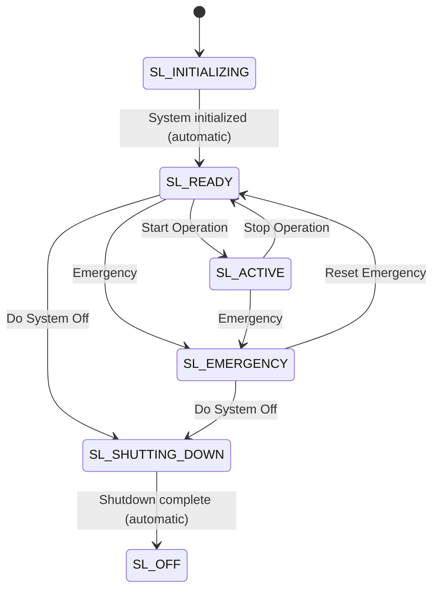

# Safety System

## The concept

The safety system decides **what the robot is allowed to do**. It is the only component that can enable or disable the actuators.

It works as a *state machine*:

- The state is the **safety level**, e.g. "ready", "active" or "emergency".
- Every level defines what the actuators may do (e.g. motors disabled) and which events it accepts.
- A level only changes through an **event**, e.g. "start operation" or "emergency". An event that the current level doesn't accept is ignored.
- There are no hidden states: the safety level is everything the system needs to know to judge what is allowed.

All other components can read the safety level and can request an event, but the safety system decides whether the event is accepted. An *emergency* event always has priority.

Why a separate component? A mistake in the control system or the sequencer must not be able to make the robot unsafe. The actuators are only enabled by the safety system, and only in levels in which this is allowed.

Because everything depends on it, the safety system always has the **highest priority and the highest rate** of all components. It must be able to react at any time, even if the other components are late or stuck.

The other components don't depend on the safety level: they keep running when the actuators are disabled.

See also [Architecture Concept](SYSTEM_ARCHITECTURE.md).

## In the robot software

### Safety levels and events

An event that the current level doesn't accept is ignored. The Serial Monitor shows the warning `No transition defined for event ...`.

The labels on the arrows are the names of the buttons in the web GUI.

| Level | Motors | Accepts the events |
|---|---|---|
| Off | disabled, deep sleep | none in practice (the robot is asleep, see the warning below) |
| Shutting down | disabled | Shutdown complete |
| Emergency | disabled | Reset Emergency, Do System Off |
| Initializing | disabled | System initialized, Emergency, Do System Off |
| Ready | disabled | Start Operation, Emergency, Do System Off |
| Active | **enabled** | Stop Operation, Emergency |

After start-up, the robot goes from *Initializing* to *Ready* by itself. **The motors only turn in the level *Active*.** Press **Start Operation** in the web GUI to get there.

> [!NOTE]
> In the level *Active*, **Do System Off** is ignored. Press **Stop Operation** first.

> [!WARNING]
> In the level *Off*, the robot goes to deep sleep immediately and no longer reacts to the web GUI. Press the **EN** button (reset) on the board to restart it.

### The events and their codes

| Button in the web GUI | Event in the code | Code sent |
|---|---|---|
| Do System On | `SE_DO_SYSTEM_ON` | 0 |
| Do System Off | `SE_DO_SYSTEM_OFF` | 1 |
| System initialized | `SE_SYSTEM_INITIALIZED` | 2 |
| Shutdown complete | `SE_SYSTEM_SHUTDOWN_COMPLETE` | 3 |
| Emergency | `SE_EMERGENCY_TRIGGERED` | 4 |
| Reset Emergency | `SE_EMERGENCY_CLEARED` | 5 |
| Start Operation | `SE_START_OPERATION` | 6 |
| Stop Operation | `SE_STOP_OPERATION` | 7 |

Events wait in a short queue and are handled one after the other. An *Emergency* event is special: it deletes all waiting events, so it is handled first.

### How other components use the safety system

- **Reading the level:** `safety_system_get_level()` returns the current level. The level is also part of the telemetry.
- **Requesting a change:** `safety_system_register_event()` adds an event to the queue. The web GUI, the sequencer and the control system can all do this. The safety system decides whether the event is accepted.
- **Shutting down together:** every task registers itself with `safety_system_register_task()` and uses `while (!safety_system_is_shutting_down())` as the condition of its main loop. This way all tasks finish cleanly when the robot shuts down. You find this pattern in `control_system_task()`: leave it as it is.

### What the safety level does not do

The safety level only enables or disables the motors. It does **not** stop the control system or the sequencer. In the level *Ready*, for example:

- the control system keeps calculating,
- the sequencer keeps executing its steps, e.g. a `MOVE_TO` step stays active until its target is reached or you remove it (see [Sequencer](SEQUENCER.md#steps-and-the-safety-level)),
- but the motors don't turn.

As soon as the level is *Active* again, the robot drives.
