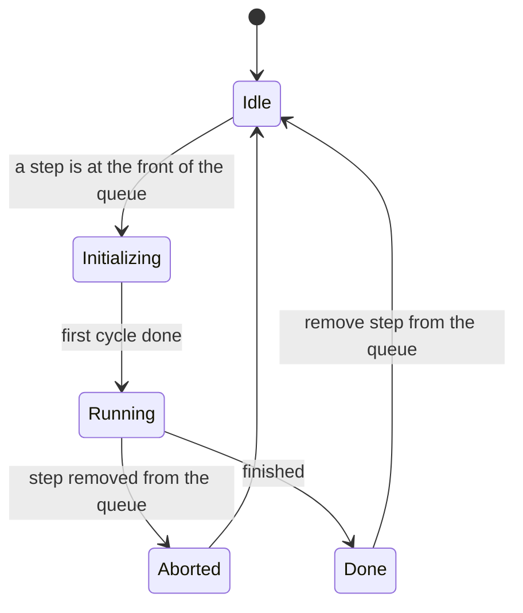

# Sequencer

## The concept

The sequencer executes the tasks of the user **one after another**. Each task is a *step*, for example "drive to this pose" or "wait for 2 s". The steps wait in a queue, and the step at the front is the active one.

The sequencer decides *what* is done next. It never sets actuator values: it hands targets over to the control system and asks whether they are reached.

It doesn't have to be fast. It is not real-time, and it runs independently of the safety level and the control loop.

See also [Architecture Concept](SYSTEM_ARCHITECTURE.md).

### How a step is executed

A step is **never executed in one go**. The sequencer runs periodically, and in every cycle it does a small piece of work for the active step:

- **Initializing:** the step starts, e.g. it hands the target to the control system.
- **Running:** in every cycle, the sequencer checks whether the step is finished. Nothing may wait inside a step: the sequencer must be able to react in every cycle.
- **Done:** the step is removed from the queue and the next step starts.
- **Aborted:** a step can be removed from the queue while it is running, e.g. by the user. The sequencer cleans up (e.g. tells the control system to stop) and continues with the next step.

## In the robot software

### The queue

- New steps are added at the end of the queue. Currently they come from the web GUI via the UDP interface.
- Every step gets an `id` from the firmware (it wraps around at 255). The web GUI shows the first steps of the queue with their `step_id` and their parameters (wait time or target pose).
- Removing a step with its `step_id` takes it out of the queue. If it is the active step, it is **aborted**.
- When the robot shuts down, all steps are removed and no new steps are accepted.

### Step types

| Step | Parameters | Finished when | On abort |
|---|---|---|---|
| WAIT | `duration_ms` | the time has passed | nothing to clean up |
| MOVE_TO | `x`, `y`, `phi` (target pose in the global frame) | the control system reports that the target is reached | the control system is told to stop |

### The code

The sequencer task runs every `SEQUENCER_TASK_PERIOD_MS` (`include/config.h`). In `lib/sequencer/src/sequencer.c`, the `switch` in `sequencer_task()` has one `case` per step type. Three flags remember where the active step is:

- `step_in_progress`: there is an active step,
- `step_initialized`: the first cycle (initialization) has been done,
- `abort_requested`: the step was removed from the queue while it was running.

Each `case` does the same three things: abort if requested, initialize in the first cycle, and check in every cycle whether the step is finished.

### The MOVE_TO step

- **First cycle:** the target pose is handed to the control system.
- **Every cycle:** the sequencer asks the control system whether the target is reached. If yes, the step is finished and removed from the queue.
- **Abort:** the control system is told to abort the movement. The robot stops.

In Exercise 5 you connect this step to the control system. The places are marked with `/* TO DO */`.

### Steps and the safety level

The sequencer doesn't depend on the safety level (see [Safety System](SAFETY_SYSTEM.md#what-the-safety-level-does-not-do)). A `MOVE_TO` step is started even if the motors are disabled, and it stays active until

- the target is reached, or
- you remove the step in the web GUI.

If the robot can't move because of the safety level, the sequencer simply stays in the step. As soon as the level changes to *Active*, the robot drives to the target and the step is finished. There is no time limit.

### Adding a new step type

All places to change in the firmware and in the web GUI are listed in the [host interface guide](../host_interface/README.md), section *B. Adding a new sequencer step type*.
