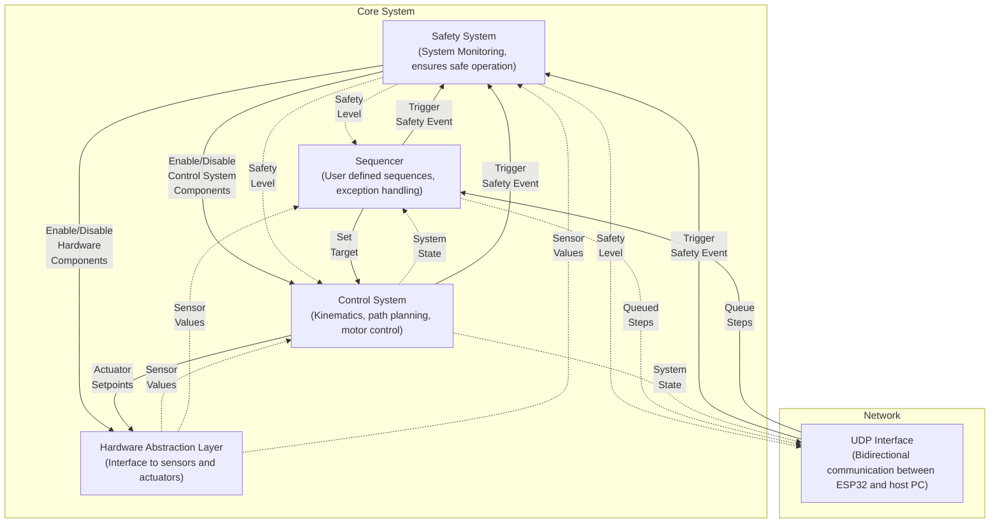

# Architecture Concept

A robot has to do several things at the same time: control its motors fast and precisely, carry out tasks one after another, communicate with a user, and stay safe in every situation. If all of this is mixed in one program, the program is hard to understand, hard to test and hard to make safe.

The solution is to **split the software into components. Each component has one clear job.** This page explains the idea. [Robot Software](ROBOT_SOFTWARE.md) shows how it is built in this project.

## The components

- **Safety System:** monitors the robot and decides what it is allowed to do. It is the only component that may enable or disable the actuators. It must be simple and predictable.
- **Control System:** the fast, periodic control loop. It reads the sensors, calculates (kinematics, controllers, ...) and sets the actuators.
- **Sequencer:** executes the tasks of the user as a sequence of steps, e.g. "drive to this pose, then wait". It decides *what* is done next, but not *how* the robot is controlled.
- **Hardware Abstraction Layer (HAL):** hides the hardware (motor drivers, encoders, ...) behind simple functions. The other components don't need to know how a sensor is read or how a motor is driven.
- **Communication interface:** exchanges data with the outside, e.g. a PC. It passes commands in and telemetry out.

More details: [Safety System](SAFETY_SYSTEM.md), [Control System](CONTROL_SYSTEM.md), [Sequencer](SEQUENCER.md), [Hardware Abstraction Layer](HAL.md) and [UDP Interface](UDP_INTERFACE.md) (the communication interface of this project).

## How they work together

Solid arrows show that a component *changes* something in another one (writes). Dashed arrows show that it only *reads*.

### Rules

1. **The Safety System has the last word.** It is the only component that enables or disables the actuators, depending on the *safety level*. All other components can read the safety level and can request a change by triggering a *safety event*.
2. **Control System and Sequencer don't depend on the safety level.** They keep running when the actuators are disabled. The Safety System makes sure that nothing moves when it is not allowed to.
3. **The Sequencer decides *what* to do, the Control System decides *how*.** The sequencer never sets actuator values. It hands over targets (e.g. a target pose) to the control system and asks whether the target is reached.
4. **Only the HAL touches the hardware.** Everything else uses the functions of the HAL.
5. **The communication interface only transports data.** It decides nothing: commands are passed on to the Safety System or the Sequencer, and telemetry is collected from the other components.

## Why split the software?

### Different timing

The components have different requirements on timing. Typical update rates:

| Component | Typical rate | Priority | Real-time |
|---|---|---|---|
| Safety System | 1000 Hz | highest | hard |
| Control System | 500 - 1000 Hz | high | hard |
| Sequencer | 50 - 100 Hz | low | no |
| Communication | about 50 Hz | low | no |
| HAL | no rate of its own | - | - |

*Real-time* means that a component must finish its work within its period, every time. A control loop that is sometimes late makes the robot unstable. The sequencer and the communication are allowed to be a little late.

**The Safety System always has the highest priority and the highest rate of all components.** It must be able to react at any time, even if all other components are late or stuck.

That's why the components run as separate *tasks* with different priorities, and the real-time tasks run on their own processor core. A slow network or a long sequencer step can never disturb the control loop.

### Independence and safety

A mistake in the sequencer or a lost network connection must not make the robot unsafe. That's why the Safety System is independent of all other components: it alone decides about the actuators, whatever the others do.

### Shared data

> [!IMPORTANT]
> Tasks run in parallel. If two tasks use the same data, e.g. a target that the sequencer sets and the control system reads, the data must be protected so that it is never read while it is being written. How this works is explained in [Control System](CONTROL_SYSTEM.md#sharing-data-with-other-tasks).

## Next

[Robot Software](ROBOT_SOFTWARE.md) shows how the components are built in this project: folders, tasks, cores and periods.
