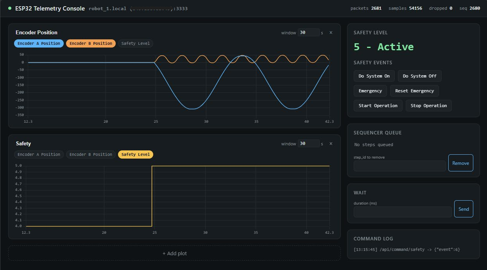

# Web GUI

The web GUI runs on your PC and shows the data the robot sends (telemetry) as live plots in your browser. You also use it to send commands to the robot, e.g. to change the safety level.



> [!IMPORTANT]
> - **Your PC must be in the same network as the robot** (not needed if your laptop is the hotspot).
> - **Only one program at a time** can receive data from the robot. Close other GUI windows or scripts first.

> [!NOTE]
> Keyboard shortcuts are given for Windows and Linux. On macOS, use `Cmd` instead of `Ctrl`. On macOS and Linux, use `python3` instead of `python`.

## Set up (once per computer)

Open a terminal in VS Code (`Ctrl+J`). It opens in your project folder.

**1. Go to the GUI folder and create a virtual environment:**

```bash
cd host_interface/gui_web
python -m venv .venv
```

**2. Activate the virtual environment:**

| System | Command |
|---|---|
| Windows (PowerShell) | `.venv\Scripts\activate` |
| macOS / Linux | `source .venv/bin/activate` |

The terminal now shows `(.venv)` at the beginning of the line. If PowerShell reports `running scripts is disabled on this system`, see [Troubleshooting](TROUBLESHOOTING.md#windows-running-scripts-is-disabled-on-this-system).

**3. Install the required packages:**

```bash
pip install -r requirements.txt
```

**4. Enter the address of your robot:** in the folder `host_interface/`, copy the file `esp32_config.json.example` and name the copy **`esp32_config.json`**. Open it and enter the hostname of your robot followed by `.local`:

```json
{
  "esp32_host": "robot_1.local",
  "esp32_port": 3333
}
```

The hostname must match `UDP_INTERFACE_HOSTNAME` in `include/config.h` ([Quick Start, Step 6](../README.md#step-6-give-your-robot-a-unique-name)). Instead of the hostname, you can also enter the robot's IP address, which the robot prints in the Serial Monitor (`Got IP: ...`).

> [!NOTE]
> `esp32_config.json` and the virtual environment are not on GitHub. Repeat these steps on every computer you work on.

## Start the GUI (every time)

1. Switch on the robot and wait until it is connected to the WiFi.
2. In the VS Code terminal, run:

   ```bash
   cd host_interface/gui_web
   ```

   Then activate the virtual environment (see the table above) and start the GUI:

   ```bash
   python app.py
   ```

3. Open <http://localhost:8080> in your browser.

The terminal shows `Connected to ESP32 at ...` when the GUI has started. To stop the GUI, click into the terminal and press `Ctrl+C`.

> [!NOTE]
> The GUI loads its plot library from the internet. Your PC needs internet access when you open the page.

## Using the GUI

| Area | What it does |
|---|---|
| **Plots** (left) | Live plots of the telemetry. Click the signal chips to choose which signals a plot shows, and change the time window (seconds). **+ Add plot** adds another plot, **&times;** removes one. |
| **Safety Level** | The current safety level of the robot. |
| **Safety Events** | Buttons that send a safety event to the robot, e.g. **Start Operation**. After start-up, the robot is in the level *Ready*. The motors only run in the level *Active*. |
| **Sequencer Queue** | The steps waiting in the sequencer, each with its `step_id`. Enter a `step_id` and click **Remove** to remove a step. |
| **Wait** | Adds a wait step with the given duration (ms) to the sequencer. |
| **Command Log** | All commands sent to the robot. |

> [!WARNING]
> **Do System Off** puts the robot into deep sleep. It then no longer reacts to the GUI. Press the **EN** button (reset) on the board to restart it.

## Something doesn't work?

See *WiFi and web GUI* in [Troubleshooting](TROUBLESHOOTING.md#wifi-and-web-gui).

## Changing the GUI

In some exercises, you send other values to the PC or add new commands. Then the GUI has to be adapted as well. All places you need to change are listed in the [host interface guide](../host_interface/README.md).
